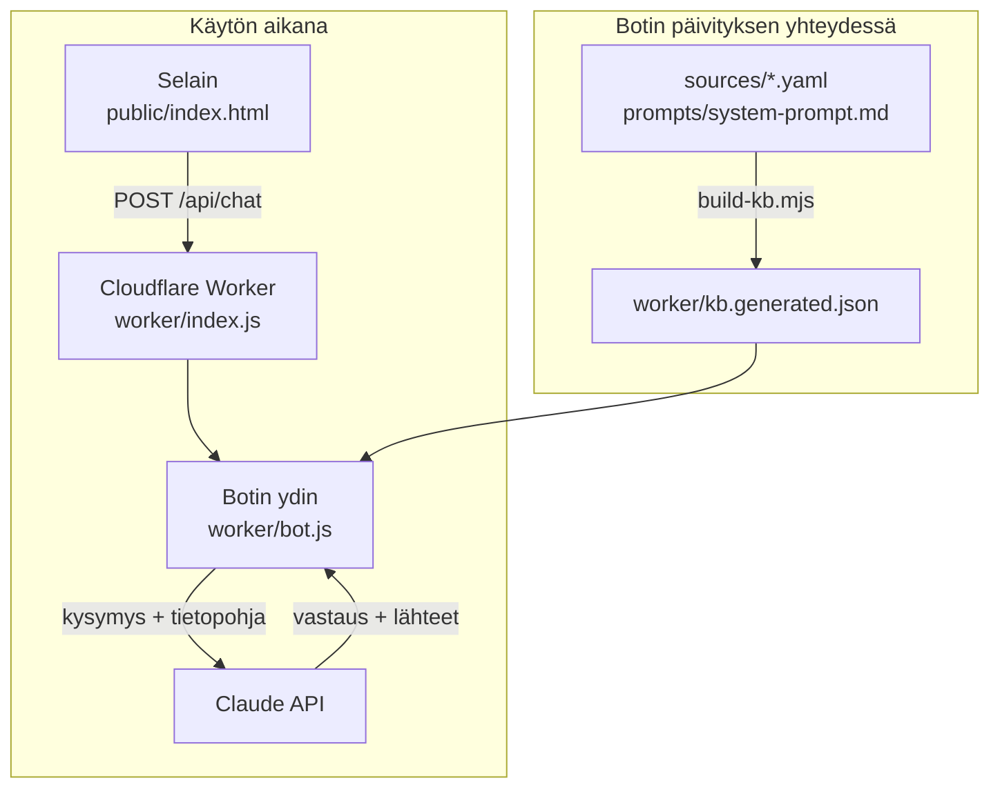

# XR-regulaatio-botti-
XR-toteutuksille sekä sovelluksille luotu AI-avusteinen botti, joka suosittelee kehittäjälle keskeisiä, avoimia standardeja sekä EU-regulaation piirissä olevien säädösten implementointia. 

## Arkkitehtuuri



- **Käyttöliittymä** (`public/index.html`) on yksi staattinen sivu, jossa käyttäjä keskustelee botin kanssa suomeksi tai englanniksi.
- **Cloudflare Worker** (`worker/index.js`) tarjoilee sivun ja vastaa osoitteessa `POST /api/chat`. API-avain on Workerin salaisuus, eikä se päädy selaimeen. Worker rajaa kysymykset 10:een minuutissa IP-osoitetta kohden, eikä se tallenna kysymyksiä.
- **Botin ydin** (`worker/bot.js`) lähettää Claude API:lle järjestelmäkehotteen, koko tietopohjan dokumentteina ja keskustelun. Claude viittaa dokumentteihin (citations), ja ydin numeroi viittaukset lähdeluetteloksi. Tietopohja merkitään välimuistiin tunnin ajaksi, joten peräkkäiset kysymykset lukevat sen välimuistista edullisemmin.
- **Tietopohja** (`sources/`) on YAML-tiedostoja. `scripts/build-kb.mjs` kokoaa ne ja botin ohjeen (`prompts/system-prompt.md`) yhdeksi JSON-tiedostoksi ennen jokaista julkaisua. Erillistä tietokantaa tai hakua ei ole: botti näkee koko tietopohjan joka kysymyksellä.

## Botin toimintalogiikka

1. **Tilanteen selvitys.** Ennen suosituksia botti kysyy puuttuvat tiedot tärkeysjärjestyksessä, enintään kolme kerrallaan: markkina-alue, mitä rakennetaan, kerättävä data, tekoälyn käyttö, toimiala (koulutus, kulttuuri, teollisuus, terveydenhuolto), 3D-sisällön lähde (tekoäly, drooni, laserkeilain, kännykkäkamera, 3D-artisti), alustan ominaisuudet sekä organisaation koko ja vaihe. Lyhyeen kysymykseen se vastaa suoraan.
2. **Vertailu tietopohjaan.** Jokaisessa tiedostossa on `applies_when`-ehdot. Botti suosittelee dokumenttia vain, jos jokin ehto täsmää käyttäjän kertomaan, ja näyttää, mikä täsmäsi. Kun ehto riippuu tiedosta, jota ei ole, botti kertoo, mikä tekisi siitä sovellettavan.
3. **Käyttötapaushuomiot** (`sources/use-cases/`) kokoavat tyypilliset tilanteet, kuten ympäristöä kuvaavat AR-lasit, droonikuvauksen tai iäkkäiden VR-käytön, ja ohjaavat oikeisiin säädöksiin ja Suomen viranomaisiin.
4. **Standardien järjestys.** Avoimesti verkossa saatavat standardit (`availability: open` tai `free-download`) suositellaan ensin. Maksulliset ISO/IEC-, MPEG-I- ja IEEE-standardit mainitaan toissijaisesti omana kohtanaan, ja niiden kohdalla kerrotaan avoin vaihtoehto (`open_alternative`).
5. **Vastaus.** Yhteenveto, todennäköisesti sovellettava sääntely (artikla, voimaantulo, Suomen viranomainen, lähdelinkki), avoimet standardit, maksulliset standardit, avoimet kysymykset ja huomautus, ettei vastaus ole oikeudellista neuvontaa.

Botti ei keksi artikloja, määräpäiviä tai linkkejä. Jos tietopohja ei kata asiaa, se sanoo sen ja ohjaa virallisiin lähteisiin. Jos tiedostossa on `todo`, botti kertoo tiedon olevan tarkistamaton. Tarkempi kuvaus kysymyksistä ja siitä, mitkä vastaukset nostavat mitäkin esiin, on tiedostossa [`docs/kysymyspolku.md`](docs/kysymyspolku.md).

## Rakenne

| Polku | Sisältö |
| --- | --- |
| `sources/eu/` | EU-säädökset, Suomen valvova viranomainen ja kansalliset ohjeet |
| `sources/fi/` | Suomen kansallinen lainsäädäntö |
| `sources/standards/` | Standardit, avoimet ja maksulliset (`availability`) |
| `sources/use-cases/` | Käyttötapaushuomiot |
| `sources/watchlist/` | Kehitteillä olevat standardit |
| `sources/_template.yaml` | Pohja ja kenttien kuvaus uudelle tiedostolle |
| `prompts/system-prompt.md` | Botin ohje |
| `docs/` | Linjaukset ja kysymyspolku |
| `public/index.html` | Käyttöliittymä |
| `worker/` | Cloudflare Worker ja botin ydin |
| `scripts/` | Tietopohjan kokoaminen ja testiajo |
| `tests/cases.yaml` | Testitapaukset |

## Testitapaukset

`tests/cases.yaml` sisältää esimerkkikysymyksiä ja odotukset vastaukselle. Botti ei näe testitapauksia, eivätkä ne vaikuta sen vastauksiin. Ne ovat laadunvarmistusta, jolla tarkistetaan, toimiiko botti oikein, kun tietopohjaa tai ohjetta muutetaan tai Claude-malli vaihtuu.

Jokaisessa tapauksessa on kysymys ja osa näistä kentistä:

| Kenttä | Tarkistus |
| --- | --- |
| `must_cite` | Lähteet, joihin vastauksen on viitattava (automaattinen) |
| `must_not_cite` | Lähteet, joita ei saa nostaa esiin (automaattinen) |
| `recommend_standards` | Standardit, jotka pitäisi suositella (raportoidaan) |
| `expect` | Asiat, jotka ihminen tarkistaa vastauksesta (rastilista raportissa) |

```bash
npm install
ANTHROPIC_API_KEY=... npm run test:bot          # kaikki tapaukset
ANTHROPIC_API_KEY=... npm run test:bot -- lyhyt-kysymys
```

Jokainen ajo kutsuu oikeaa Claude API:a (noin 0,05 $ tapausta kohden). Raportti kirjoitetaan kansioon `tests/results/`. Aja testit ainakin ennen jokaista julkaisua, jossa tietopohja tai ohje muuttuu.

## Julkaisu Cloudflareen

1. Cloudflaressa: *Workers & Pages → Create → Import a repository* ja valitse tämä repo. Asetukset luetaan tiedostosta `wrangler.jsonc`.
2. Workerin *Settings → Variables and Secrets*: lisää salaisuus `ANTHROPIC_API_KEY`.
3. Jokainen muutos main-haaraan julkaistaan automaattisesti. Tietopohja kootaan YAML-tiedostoista julkaisun yhteydessä.

Kulut rajataan Claude Consolen kuukausirajalla. Paikallinen kehityspalvelin: avain tiedostoon `.dev.vars` ja `npm run dev`.
